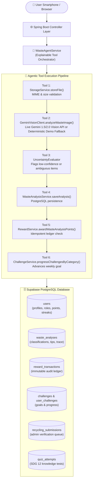

<div align="center">

# ♻️ EcoSort AI — Smart Waste Segregation
### *Agentic Waste Management & Green Rewards Platform*

[](https://sdgs.un.org/goals/goal12)
[](https://openjdk.org/projects/jdk/21/)
[](https://spring.io/projects/spring-boot)
[](https://aistudio.google.com/)
[](https://supabase.com/)

> ***"Turn Everyday Waste into Everyday Impact."***  
> *Identify Waste • Earn EcoPoints • Compete Locally • Build a Greener Community*

**👤 Project Owner & Lead Developer:** **PARTH MISHRA**

---

[📖 Overview](#-project-overview--problem-statement) •
[🛠️ Tech Stack](#️-technology-stack) •
[🏗️ Architecture](#️-system-architecture--agentic-workflow) •
[⚡ Quickstart](#-quickstart-guide-zero-config) •
[🔐 Demo Accounts](#-pre-seeded-demonstration-accounts) •
[🎬 Evaluator Walkthrough](#-interactive-evaluator-demo-script)

</div>

---

## 📖 Project Overview & Problem Statement

Urban households and citizens often struggle to distinguish recyclable packaging from non-recyclable items and frequently lack guidance on safe disposal of hazardous waste (such as lithium-ion cells, damaged electronics, and chemical containers). Moreover, many people lack the motivation to segregate waste at source consistently because they receive no feedback, recognition, or incentive.

**EcoSort AI** bridges this gap through:

| Feature Pillar | How EcoSort AI Delivers Impact |
| :--- | :--- |
| 🧠 **AI Visual Perception** | Identifies household waste from smartphone photos using vision-capable Gemini AI (with a clearly labeled rule-based demo fallback). |
| 🗑️ **Municipal Segregation Guidance** | Recommends exact disposal streams (*Blue Dry Recyclables*, *Green Wet Composting*, or *Authorized E-Waste centers*) with preparation tips and safety warnings. |
| 🪙 **Transparent EcoPoints** | Rewards verified activities using an immutable audit ledger with cryptographic idempotency keys. |
| 🏆 **Community Leaderboards & Challenges** | Encourages friendly competition across municipal wards without exposing private resident addresses. |
| 🤝 **Proposed Green Rewards Roadmap** | A conceptual municipal and local business partnership framework designed for civic expansion. |

---

## 🛠️ Technology Stack

| Layer | Technologies Used |
| :--- | :--- |
| **Backend Core** | Java 21 & Spring Boot 3.3.4 |
| **Database** | Supabase PostgreSQL (with embedded PostgreSQL-compatible H2 fallback for zero-config local evaluation) |
| **Persistence** | Spring Data JPA and Hibernate |
| **Frontend & UI** | Thymeleaf, HTML5, CSS3, JavaScript (ES6), Bootstrap 5.3, Bootstrap Icons |
| **Data Visualization** | Chart.js (category distribution doughnut chart) |
| **AI Vision Engine** | Google Gemini Vision API (`gemini-1.5-flash` / `gemini-2.0-flash`) |
| **Security** | Spring Security with BCrypt password hashing and role-based access control (`ROLE_USER`, `ROLE_ADMIN`) |
| **Build Tool** | Maven 3.9+ (includes standalone `./mvn` and `./mvnw` wrappers) |

---

## 🏗️ System Architecture & Agentic Workflow



### 🛡️ Deterministic Zero-Cheat Rules
- **Idempotent Rewards:** Every point transaction is assigned a unique `activityReference` (e.g., `waste-analysis-12`, `quiz-sdg12-user-3`). Duplicate requests are rejected without double-crediting.
- **Daily Limits:** Scans are capped to prevent point farming (default max 10 pts/day).
- **Physical Recycling Verification:** A photo scan is never treated as proof of physical recycling. Physical recycling drop-offs are submitted with weight/description and require administrative verification before 15 EcoPoints are issued.

---

## ⚡ Quickstart Guide (Zero-Config)

> [!TIP]
> **Zero-Config Mode:** If no database or Gemini API keys are provided, the application automatically runs in local zero-config mode with embedded PostgreSQL-compatible H2 and the clearly labeled Demo Mode fallback.

### Prerequisites
- **Java 21** installed (`java -version`)
- No other external installations required (the project includes a pre-configured Maven wrapper `./mvn`).

### 1. Clone & Enter Directory
```bash
cd /Users/parthmishra/Desktop/Trash2Treasure/AI-SMART-BASED-SMART-SEGREGATION-SYSTEM
```

### 2. Configure Environment (Optional)
```bash
cp .env.example .env
```

### 3. Build & Run Automated Test Suite
```bash
./mvn clean test
```
*All unit and integration tests (including idempotency checks, scoring, and daily caps) will execute and pass.*

### 4. Start the Application
```bash
./mvn spring-boot:run
```
The server will start on port `8080`. Open your browser and navigate to:  
👉 **[http://localhost:8080](http://localhost:8080)**

---

## 🔐 Pre-Seeded Demonstration Accounts

For rapid evaluator testing, the database is pre-seeded with test accounts:

| Role | Username | Password | Purpose |
| :--- | :---: | :---: | :--- |
| **🧑 Citizen User** | `demo_user` | `demo123` | Pre-populated with 4 historical waste analyses, 42 EcoPoints, active streak, and sample transactions. |
| **🛡️ Administrator** | `admin` | `admin123` | Full access to `/admin` console to review recycling submissions, inspect the global ledger, and manage challenges. |

*Sample community leaderboard participants (`demo_sarah`, `demo_arjun`, etc.) are explicitly tagged with `[DEMO DATA]` badges to preserve academic integrity.*

---

## ⚙️ Cloud & AI Configuration (Optional)

<details>
<summary><b>🗄️ 1. Supabase PostgreSQL Configuration (Click to Expand)</b></summary>
<br/>

1. Create a project at [supabase.com](https://supabase.com).
2. Go to **Project Settings** -> **Database** and copy the **Connection string (URI)**.
3. Set the following environment variables (or specify them in `application.properties`):
```bash
export SPRING_DATASOURCE_URL="jdbc:postgresql://<YOUR_PROJECT_REF>.supabase.co:5432/postgres?sslmode=require"
export SPRING_DATASOURCE_USERNAME="postgres"
export SPRING_DATASOURCE_PASSWORD="<YOUR_SUPABASE_PASSWORD>"
export SPRING_DATASOURCE_DRIVER="org.postgresql.Driver"
```
4. Run the application; Hibernate will automatically create all tables and indexes, or you can manually execute `src/main/resources/schema.sql` in the Supabase SQL Editor.

</details>

<details>
<summary><b>🤖 2. Google Gemini Vision Configuration & Demo Fallback (Click to Expand)</b></summary>
<br/>

1. Obtain a free API key at [Google AI Studio](https://aistudio.google.com/).
2. Set the environment variable:
```bash
export GEMINI_API_KEY="AIzaSy..."
export GEMINI_MODEL="gemini-1.5-flash"
```
3. Restart the application. Uploaded images will be sent directly to Gemini 1.5/2.0 Vision.

**Clearly Labeled Demo Fallback:**  
If `GEMINI_API_KEY` is omitted or if the external API is unreachable, the system automatically triggers the rule-based heuristic demo analyzer and displays an amber alert:
> **DEMO MODE NOTICE:** This classification was generated via the offline deterministic fallback engine because an external Gemini API key was not configured. This did not originate from a live cloud AI model.

</details>

---

## 🎬 Interactive Evaluator Demo Script

Present this step-by-step workflow to college internship evaluators:

<details open>
<summary><b>📋 Steps 1–5: Core AI Scanning & Citizen Dashboard</b></summary>

1. **Homepage & SDG 12 Mission (`/`):**
   - Highlight the UN SDG 12 sustainability badge and the core value proposition: *"Turn Everyday Waste into Everyday Impact."*
   - Review the 4-step pipeline and the supported municipal waste categories.
2. **Citizen Login (`/login`):**
   - Click "Citizen Login" and sign in with `demo_user` / `demo123`.
3. **Dashboard & Persisted Metrics (`/dashboard`):**
   - Show the 4 stat cards (*Total EcoPoints: 42, Items Analyzed: 4, Daily Streak: 3 Days, Rank: #4*).
   - Point out the **Chart.js doughnut chart** generated from persisted user data.
   - Show the personalized AI recommendations and active weekly challenges.
4. **AI Waste Scanner (`/scan`):**
   - Drag-and-drop or select any photo (e.g., plastic bottle or kitchen scraps).
   - Click **"Analyze Waste with AI (+2 EcoPoints)"**.
   - Review the analysis result page (`/scan/result/{id}`):
     - Assigned category banner (e.g., *Recyclable plastic* in blue or *Organic wet waste* in green).
     - Actionable disposal instructions, 4R reuse tips, and safety warnings.
     - Expand the **Explainable AI Agent Tool Execution Trace** accordion to show the structured tool invocations (`StorageService` -> `GeminiVisionClient` -> `WasteAnalysisService` -> `RewardService`).
5. **SDG 12 Knowledge Quiz (`/quiz`):**
   - Answer the 5 interactive questions on municipal segregation and UN SDG 12.
   - Submit and review the instant score, educational explanations, and +5 EcoPoints reward.

</details>

<details>
<summary><b>🏆 Steps 6–10: Audit Ledger, Leaderboards & Admin Verification</b></summary>

6. **EcoPoints Immutable Audit Ledger (`/ecopoints`):**
   - Review the immutable ledger table showing exact timestamps, activity types, reasons, points credited, and unique idempotency keys.
   - Note the recalculated balance matching the ledger balance.
7. **Ward Leaderboard (`/leaderboard`):**
   - Demonstrate the municipal ward filter dropdown (e.g., filter by *Ward 12 - Green Valley*).
   - Show the `YOU` highlight on `demo_user` and the `[DEMO DATA]` badges on sample participants.
8. **Recycling Drop-off Verification Workflow (`/recycling`):**
   - Submit a new batch (e.g., *"3 kg Plastic Bottles to Municipal Dry Center"*).
   - Notice that the status is marked **PENDING** (points are not awarded until admin verification).
9. **Municipal Administrator Console (`/admin`):**
   - Log out and log in as `admin` / `admin123`.
   - Navigate to `/admin` and review the pending recycling verification queue.
   - Click **"Approve (+15 pts)"** on a pending submission and observe the immediate credit in the global system ledger.
10. **Proposed Municipal Rewards Page (`/rewards`):**
    - Explain the transparent project disclosure confirming that points are currently virtual and future municipal/business partnerships are proposed extensions.

</details>

---

## 🔮 Known Limitations & Future Extensibility

- **Image Retention:** For maximum privacy, images are stored locally in `uploads/` with UUID-masked filenames. Supabase Storage can be attached for persistent multi-node deployments.
- **Commercial Redemptions:** Cash payments or merchant coupons are strictly marked as proposed concepts; the application architecture is prepared with an immutable ledger to integrate real municipal partner APIs in Phase 2.
- **Offline Vision:** The demo fallback is limited to standard household item heuristics when running offline without Gemini API credentials.

---

## 👤 Owner & Academic Attribution

- **Project Owner & Lead Developer:** **PARTH MISHRA**
- **Academic Compliance:** Developed for college internship presentation conforming to **United Nations Sustainable Development Goal 12: Responsible Consumption and Production**.
- **Built With:** Spring Boot 3.3 • Java 21 • Thymeleaf • Google Gemini Vision • Supabase PostgreSQL
